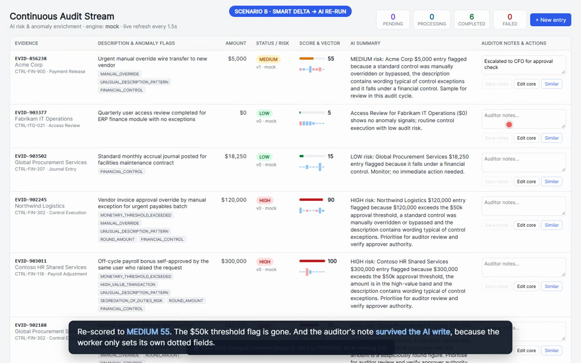
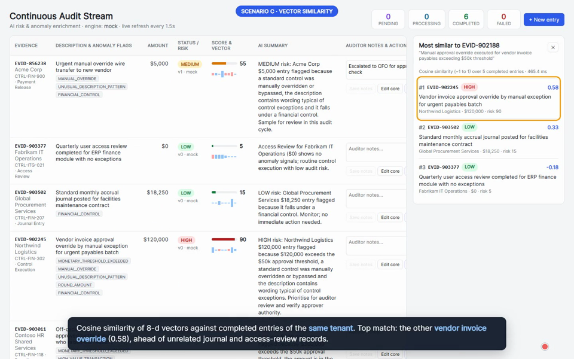

# AI-Enriched Continuous Audit Pipeline (MERN)

Prototype of an audit SaaS backend and dashboard. Evidence records are saved instantly as `PENDING`. A background worker enriches them with an AI risk score, risk level, summary, anomaly flags and an 8-dimensional semantic vector. Edits are routed so that only changes to core financial fields re-run the AI, while auditor-note edits are fast-tracked with a single atomic write. Each row can surface its top 3 most similar historical exceptions.

**Stack:** Node.js 22 + Express (ES6 classes) · MongoDB + Mongoose · React 18 (class components) + Vite.

## Quick start

**Requirements:** Node.js **22 or newer** (`node -v`); the npm scripts use `--env-file-if-exists`, which older versions don't support. No MongoDB install is needed.

> **First install takes a few minutes.** `npm install` downloads a MongoDB server binary once for the in-memory database (about 100 MB on macOS/Linux, about 600 MB on Windows, roughly 1–6 minutes depending on your connection). Later installs and runs reuse it. If you set `MONGO_URI` to your own MongoDB, the in-memory server is never started.

```bash
npm install
npm run dev        # API on :4000, dashboard on http://localhost:5173
```

That's all. With no `MONGO_URI` set, the API starts an **in-memory MongoDB** and seeds 5 sample entries automatically, so you can review the project without installing a database. The first start downloads the MongoDB binary once, which can take a minute.

### With your own MongoDB

```bash
cp .env.example .env          # set MONGO_URI=mongodb://127.0.0.1:27017/smartaudit (or an Atlas URI)
npm run seed                  # resets the demo tenant to 5 PENDING sample entries
npm run dev
```

`npm run seed` without `MONGO_URI` posts the samples to the running API instead.

### Using a real LLM

```bash
MOCK_AI=false
OPENAI_API_KEY=sk-...
```

With `MOCK_AI=true` (the default when no key is set), a deterministic local engine runs with the 400 ms simulated latency from the brief.

### Tests

```bash
npm test     # 21 tests: unit + full pipeline against in-memory MongoDB
```

## Environment (`.env.example`)

| Variable | Default | Purpose |
|---|---|---|
| `MONGO_URI` | *(empty, in-memory)* | MongoDB connection string |
| `PORT` | `4000` | API port |
| `MOCK_AI` | `true` if no key | Local AI engine vs OpenAI |
| `OPENAI_API_KEY` | | Needed only when `MOCK_AI=false` |
| `OPENAI_MODEL` / `OPENAI_EMBEDDING_MODEL` | `gpt-4o-mini` / `text-embedding-3-small` | LLM and embedding models |
| `AI_MAX_RPM` | `60` | Client-side LLM rate limit |
| `WORKER_POLL_MS` / `WORKER_CONCURRENCY` | `1000` / `2` | Worker polling interval and parallel jobs |
| `WORKER_LOCK_TTL_MS` | `30000` | After this, a `PROCESSING` job is treated as crashed and reclaimed |
| `WORKER_MAX_ATTEMPTS` | `3` | Attempts before an entry is marked `FAILED` |

## API

| Method | Path | Behaviour |
|---|---|---|
| `POST` | `/api/audit-entries` | Validates and saves with `aiMetadata.status = PENDING`, returns **202**, wakes the worker |
| `GET` | `/api/audit-entries` | Entries for the tenant (newest first) and queue stats |
| `GET` | `/api/audit-entries/:id` | One entry |
| `PUT` | `/api/audit-entries/:id` | Smart delta evaluation; the response includes `path`: `FAST_TRACK`, `AI_REQUEUE` or `NO_CHANGE` |
| `POST` | `/api/audit-entries/:id/similar` | Top 3 (`?k=` up to 10) most similar completed entries of the same tenant |
| `POST` | `/api/audit-entries/:id/retry` | Re-queues a `FAILED` entry |
| `GET` | `/api/health` | AI mode, worker state, database state |

Tenant scoping: requests use the `x-tenant-id` header, or the demo tenant if it's absent. Every query is filtered by tenant.

## Architecture

```
server/src
├── models/AuditEntry.js            schema (baseline + aiMetadata bookkeeping), indexes
├── repositories/AuditRepository.js all DB access; every write is a targeted $set/$inc
├── services/AIService.js           AI orchestration: mock vs OpenAI, retries, fallback, validation
├── services/MockAIEngine.js        deterministic local evaluator (rules + 400 ms latency)
├── services/OpenAIProvider.js      fetch-based OpenAI client (JSON mode + 8-d embeddings)
├── services/RateLimiter.js         spaces LLM calls to AI_MAX_RPM
├── services/AIWorkerService.js     background queue consumer
├── controllers/AuditController.js  HTTP handlers (create / list / delta update / similar / retry)
├── lib/delta.js                    payload whitelist + value-level change detection
├── lib/vector.js                   hash embedding, cosine similarity, top-k
├── container.js                    constructor injection (tests swap in a failing AI, etc.)
└── index.js / seed.js
client/src/AuditDashboard.jsx       class component: live table, badges, notes, core edit, similarity panel
```

## Design decisions (technical review topics)

### 1. Asynchronous architecture: MongoDB as the queue
The `aiMetadata.status` field *is* the queue. Workers claim a job with one atomic `findOneAndUpdate` (`PENDING → PROCESSING`, `$inc attempts`, set `lockedAt`), sorted by `queuedAt` for FIFO. MongoDB's document-level atomicity guarantees two workers, or two API instances, never claim the same entry. A test fires 8 parallel claims at 5 jobs and checks there are no duplicates.

- **Why not a broker yet:** one source of truth. Writing a record and enqueuing a job are the same write, so there's no dual-write problem and no outbox needed. Crash recovery is built in: a job whose `lockedAt` is older than `WORKER_LOCK_TTL_MS` is simply claimable again.
- **Latency:** the worker polls every `WORKER_POLL_MS`, but `POST`/`PUT` call `worker.notify()` to wake it immediately.
- **Failures:** exponential backoff via `nextAttemptAt` (2 s, 4 s, …), then `FAILED` after `WORKER_MAX_ATTEMPTS`, with `lastError` stored. `POST /:id/retry` re-queues it.
- **When I'd switch** to BullMQ/Redis or SQS: high throughput where polling costs matter, priority queues, fan-out, or many worker services. Change streams on the `status` field are a middle step that removes polling while keeping MongoDB as the source of truth.

### 2. Concurrency: version guard and dot-path writes
Two races the naive design gets wrong:

1. **A core field is edited while the AI is processing the old values.** Every core edit does `$inc aiMetadata.version` and sets `status = PENDING`. The worker writes results with the filter `{ _id, 'aiMetadata.version': <version it read>, status: 'PROCESSING' }`. If the record changed meanwhile, nothing matches, the stale result is dropped, and the entry is processed again with the new values. *(test: "stale AI result is discarded")*
2. **An auditor saves notes while the worker is writing results.** The worker never replaces the `aiMetadata` object. It `$set`s only its own dotted paths (`aiMetadata.riskScore`, `aiMetadata.aiSummary`, …), so `aiMetadata.auditorNotes` can't be overwritten. Notes don't bump the version, because they don't affect the assessment, so that AI result stays valid. *(test: "notes written during AI processing are not overwritten")*

### 3. Delta evaluation and fast-tracking
`PUT` compares **values**, not key presence, against the stored document after normalising (number cast, trimmed strings):

| Result | Write | AI |
|---|---|---|
| a core field (`monetaryImpact`, `description`, `controlId`) changed | `$set` changed fields + `status: PENDING` + `$inc version` | re-runs |
| only `auditorNotes` changed | one atomic `$set` on `aiMetadata.auditorNotes` | **bypassed** |
| nothing changed | none | none |

Re-submitting a whole form with unchanged financials (e.g. `"85000"` vs `85000`) therefore never triggers an expensive AI call. The payload is whitelisted: baseline evidence (`evidenceId`, `tenantId`, …) and AI output can't be edited through `PUT`.

### 4. AI workload integration
- **Mock strategy:** `MockAIEngine` is deterministic. Additive weighted rules on amount vs the $50k threshold, the high-value band, override/bypass wording, exception wording, segregation-of-duties phrases, round amounts and financial controls. This makes the demo and tests reproducible and lets the project run offline.
- **LLM path:** JSON mode with a constrained schema, temperature 0.2.
  - Output is **validated, never trusted**: score clamped to 0–100, flags whitelisted, summary required.
  - `riskLevel` is derived from `riskScore`, so the two can never disagree.
- **Rate limiting and errors:**
  - A client-side limiter spaces calls to `AI_MAX_RPM`.
  - 429, 5xx and timeouts are retried in-call with backoff; 4xx errors are not retried.
  - If the LLM still fails, the engine **falls back to the local evaluator** so the queue keeps moving; the record is tagged `provider: mock-fallback`.
  - Worker concurrency caps parallel AI calls.
- **In production:** a shared (Redis) rate limiter across instances, a cost and latency budget per tenant, and a circuit breaker instead of per-call fallback.

### 5. Vector similarity
- **Mock embeddings** are not random. They use signed feature hashing of description tokens and bigrams into 8 buckets, L2-normalised, so texts sharing vocabulary point the same way and cosine similarity is meaningful. With OpenAI, `text-embedding-3-small` is called with `dimensions: 8`.
- Each vector stores its `vectorModel`; similarity compares **only vectors from the same model**, because mixing embedding spaces gives meaningless scores.
- `/similar` loads the tenant's `COMPLETED` candidates using an index on `{tenantId, status}` and a projection that excludes notes and other payload. It computes cosine in Node and keeps a bounded top-k list (O(n·k)) instead of sorting everything. The response reports `scanned` and `tookMs`.
- **Scale path:** brute force is fine for thousands of rows per tenant. Beyond that, use MongoDB Atlas `$vectorSearch` (HNSW index, `filter: { tenantId }`) or pgvector, and keep the same API.

## Walkthrough video

**[⬇ Download the 72-second walkthrough (MP4, 3 MB)](https://github.com/yashsharma499/smartaudit-assessment/raw/main/docs/walkthrough.mp4)**

**How to play it:** GitHub can't preview video files in the browser (it shows "Sorry, we can't show files that are this big"), so:
- click the download link above, or open [`docs/walkthrough.mp4`](docs/walkthrough.mp4) and use the **Download raw file** button (↓ icon, top right), then open the file with any video player (it's a standard H.264 MP4: VLC, Windows Media Player, QuickTime, or drag it into a browser tab);
- or, if you've cloned the repo, open `docs/walkthrough.mp4` locally.

It's a captioned screen recording of the running app (no audio) showing:
1. a new record entering as `PENDING` and receiving its risk score, summary, anomaly flags and 8-d vector;
2. an auditor-notes edit fast-tracking with one atomic `$set` (status and version unchanged, AI not re-run);
3. an amount edit going back to `PENDING` (version bumped) and being re-scored, with the note preserved;
4. the Similar panel returning the top 3 by cosine similarity.

| Core edit → re-scored, note preserved | Vector similarity |
|---|---|
|  |  |

## Known limitations
- Single demo tenant in the UI (the API is multi-tenant).
- No authentication; tenant comes from a header.
- The dashboard polls every 1.5 s. SSE or WebSockets would push changes instead.
